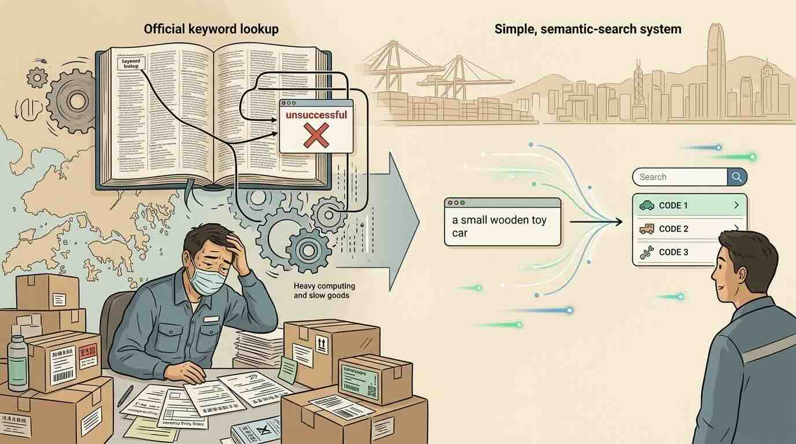
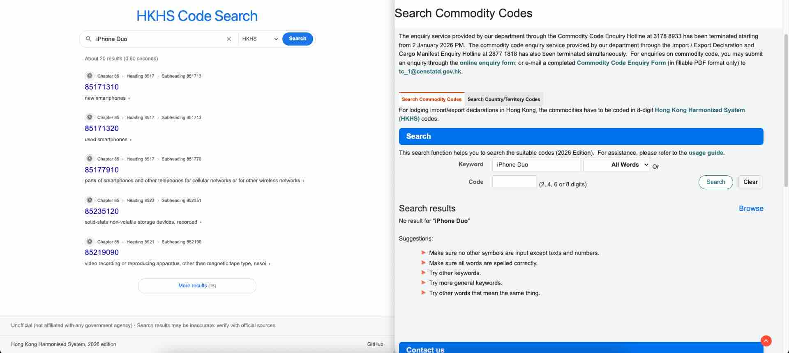
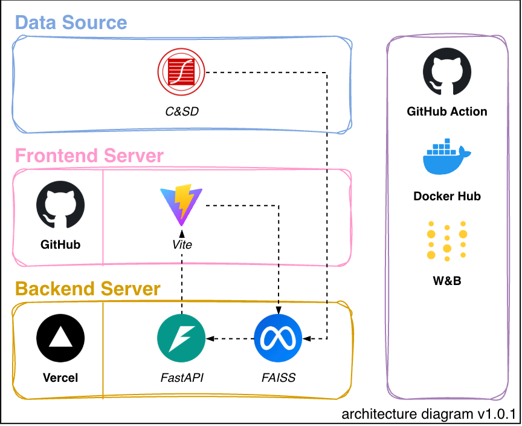

<!-- INTRODUCTION -->
# 🔍 HKHS Code Search
Every parcel that crosses a border carries a secret number. The [Harmonised System](https://www.wcoomd.org/en/topics/nomenclature/overview/what-is-the-harmonized-system.aspx) is the six-digit language spoken by customs authorities around the world, and Hong Kong extends it to eight digits as the Hong Kong Harmonised System (HKHS). There are over 7,800 of these codes, each written in a legal dialect that reads like "_other, not elsewhere specified or included_". It is precise for lawyers and hopeless for everyone else.

Make your first query with HKHS Code Search, a search engine that lets you describe what the goods actually are, such as "acoustic guitar" or "almond milk", and returns the most likely codes at whichever level of the hierarchy you need. Start with the words you know and get a practical shortlist of codes from the official tariff.

  

  
  
  
<strong>First Published:</strong> 16 September 2026 <strong>Last Updated:</strong> 11 October 2026

<!-- ROADMAP -->
## Table of Contents
- [1 - Why We Built HKHS Code Search](#1)
  - [1.1 - Does it really work?](#1.1)
- [2 - Which Code Do I Declare?](#2)
- [3 - Behind the Scenes](#3)

<!-- SECTION 1 -->

## Why We Built HKHS Code Search
Anyone importing or exporting through Hong Kong must lodge a declaration within 14 days, and every line on it needs an eight-digit HKHS code. The [official lookup](https://www.censtatd.gov.hk/en/index_hs_code.html) is a keyword browser that only helps if you already know that a guitar is a "_string musical instrument_". The fashionable fix is to ask a large language model (LLM), and it does work. A fine-tuned model lands on the right six-digit subheading [about 58% of the time](https://arxiv.org/html/2509.18400v1). But picking one of 7,800 fixed labels is a lookup task, not a writing task. Answering it with an LLM means using a GPU for every query, with seconds of latency rather than milliseconds, and that cost is one of the reasons generative AI projects [die after the proof of concept](https://www.gartner.com/en/newsroom/press-releases/2024-07-29-gartner-predicts-30-percent-of-generative-ai-projects-will-be-abandoned-after-proof-of-concept-by-end-of-2025).

There is no absolutely correct way to classify goods, only approaches that fit the job better or worse. HKHS Code Search treats the problem as semantic search. Every HKHS description is embedded once with a sentence transformer, and each query simply returns its nearest neighbours. The index contains only real codes, so it cannot invent one. It achieves a similar level of accuracy to the LLM approach at a fraction of the cost.

  
  
<i>solutions vary, but the more efficient one wins.</i>

### Does it really work?
We evaluate against 1,153 product names held out from the search index. With fine-tuning, Recall@10 reaches 95% for chapters, 88% for headings, and 80% for subheadings. Recall@5 reaches 92%, 83%, and 72% respectively. A comparison with the official lookup makes the point. When the same keyword "_iPhone Duo_" is entered into both systems, the official keyword search returns nothing, while HKHS Code Search identifies the correct code. The reason is that the model bridges the gap between everyday product language and the tariff's formal descriptions, even when they share few or no words.

  
  
<i>semantic search finds what keyword search misses.</i>

<!-- SECTION 2 -->

## Which Code Do I Declare?
Type a description of the goods, pick a level of the hierarchy, and the search returns the relevant codes together with the official descriptions that matched. The results are ranked by semantic similarity, so a query like "almond milk" can surface the most relevant chapter, heading, or subheading without needing the precise tariff wording in advance. That makes it easier to narrow the declaration to the right level before submitting a customs entry.

> [!NOTE]  
> Latency is expected because HKHS Code Search relies on free-tier services, a cold start may add a few seconds to your first query.

  
  
<i>from a rough product description to a declaration-ready shortlist of HKHS codes.</i>

<!-- SECTION 3 -->

## Behind the Scenes
HKHS Code Search depends on the [HKHS 2026 edition](https://www.censtatd.gov.hk/en/EIndexbySubject.html?pcode=B2XX0023&scode=230), published by the **Census and Statistics Department**, which covers the legal description of every HKHS code. Product examples are drawn from [Japan Post](https://www.post.japanpost.jp/service/send/oversea/use/label/hscode/index.php) to serve as the held-out evaluation set.

Users enter a product description into the web app built with **Vite**, which sends a request to the **FastAPI** backend to search for the relevant HKHS codes. The search index is built with _FAISS_ because it is lightweight and efficient. The underlying _Sentence Transformers_ model was fine-tuned with synthetic data and combined with _BM25_ to create a hybrid engine that improves retrieval.

The API runs on **Vercel**'s Hobby plan, and the frontend is hosted on **GitHub Pages**. Due to free-tier limits, a cold start may add a few seconds to a query, and service disruptions may occur.

  

<!-- DISCLAIMER -->
---

**This was created as a personal hobby project and learning exercise.**
